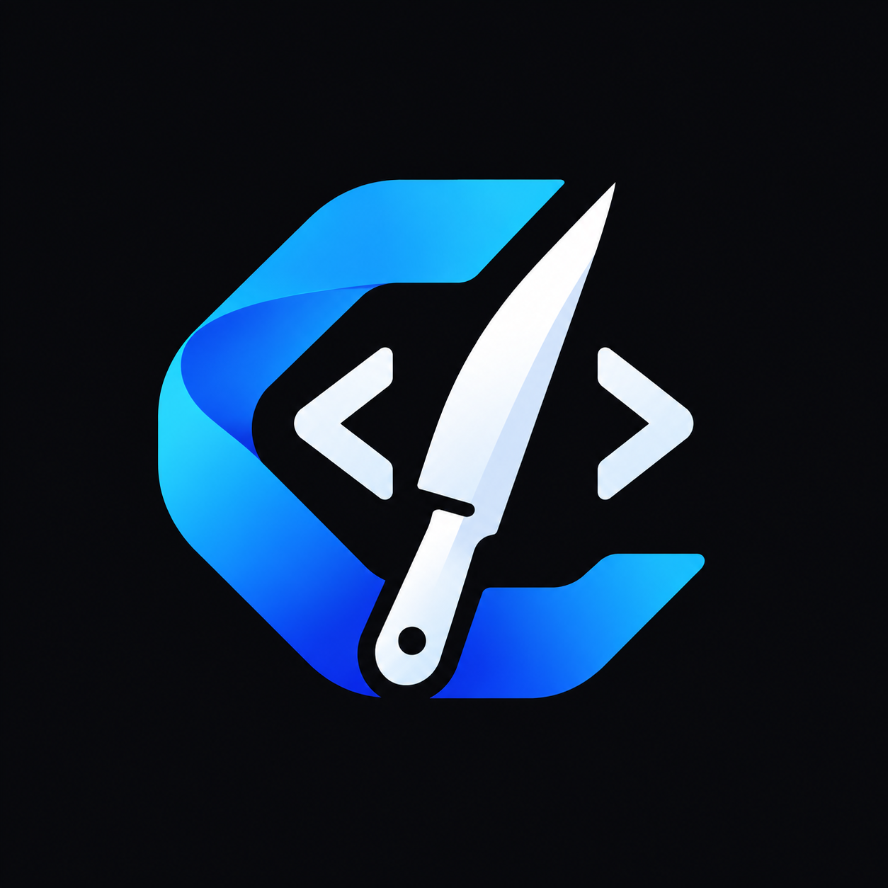
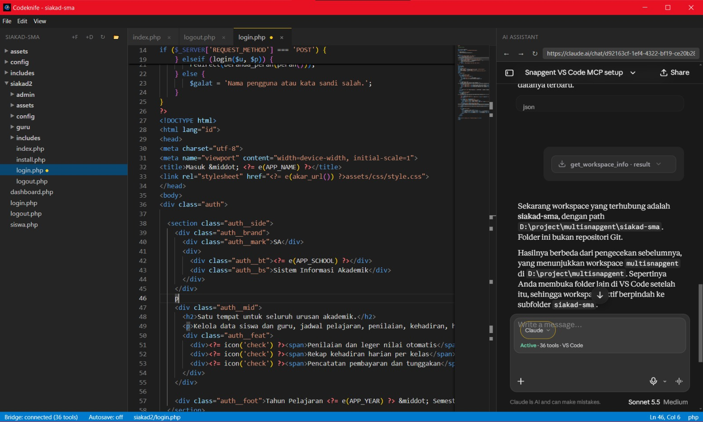

# :knife: Codeknife

### Agentic Development Environment
**A code editor and an AI assistant in one app. Just ask, and the AI does the work.**

 

[:arrow_down: Download](https://github.com/herdodp/codeknife-ADE/releases/latest) &nbsp;|&nbsp; [:rocket: Quick Start](#quick-start-in-4-steps) &nbsp;|&nbsp; [:speech_balloon: Example Prompts](#example-prompts) &nbsp;|&nbsp; [:question: FAQ](#faq)

 

---

## :sparkles: What is Codeknife?

Codeknife is an app where you write code **with an AI assistant by your side**. Your project files are listed on the left, the editor sits in the middle, and the AI is ready to help on the right.

No more copying code back and forth between your browser and your editor. The AI in Codeknife can **see your project**, **open files**, and **change code** directly, based on what you ask.

> :bulb: Think of a teammate sitting next to you who knows your whole project and does what you ask.

 

## :dart: What You Can Do

<table>
<tr>
<td width="50%" valign="top">

### :open_file_folder: Explore Your Project
Open a folder and everything inside appears neatly in the left panel. Click any file to open it.

</td>
<td width="50%" valign="top">

### :pencil2: Edit Comfortably
An editor with tabs, syntax colors, and error markers, just like a professional code editor.

</td>
</tr>
<tr>
<td width="50%" valign="top">

### :robot: Chat with AI
The AI panel is on the right. Pick your favorite AI service, sign in with your account, and start asking.

</td>
<td width="50%" valign="top">

### :zap: AI That Works Directly
Ask the AI to open files, read code, fix bugs, or create new files. The results show up right in the editor.

</td>
</tr>
</table>

 

## :rocket: Quick Start in 4 Steps

### Step 1. Download and install
Go to the **[Releases](https://github.com/herdodp/codeknife-ADE/releases/latest)** page and pick one of two options:

- **Installer** (`Codeknife.Setup.0.1.0.exe`): run it like any other Windows app.
- **Portable** (`Codeknife-0.1.0-win-portable.zip`): extract the zip anywhere and run `Codeknife.exe`. No installation needed.

### Step 2. Open your project folder
Press **`Ctrl + O`** and choose your project folder. Its contents will appear in the left panel.

> :pushpin: Codeknife remembers the last folder you opened and reopens it next time.

### Step 3. Pick an AI and sign in
In the right panel, choose the AI service you like and sign in with your account.

<b>:brain: Supported AI services</b> (click to expand)

 

| | | | |
|:---:|:---:|:---:|:---:|
| **Claude** | **ChatGPT** | **Gemini** | **DeepSeek** |
| **Grok** | **Mistral** | **Qwen** | **Kimi** |
| **GLM** | **Meta AI** | **Arena** | **Ptero** |

### Step 4. Press **Start**
When the Start button in the AI panel is active and says *Ready*, press it. The AI connects to your project and is ready for your requests.

 

## :speech_balloon: Example Prompts

Write your request in everyday language. Some ideas:

| You want to... | Try typing |
|---|---|
| :book: Understand the project | *"Explain the structure of this project and what each folder does."* |
| :page_facing_up: Open a file | *"Open `renderer/app.js` in the editor."* |
| :beetle: Find a problem | *"Find out why the Start button is disabled and fix it."* |
| :sparkles: Add a feature | *"Add a button to save all files at once."* |
| :broom: Tidy up | *"Clean up the variable names in this file."* |
| :memo: Create a file | *"Create `notes.md` with my to-do list for today."* |

> :warning: For big changes or deletions, the AI will ask for your approval first.

 

## :keyboard: Keyboard Shortcuts

| Keys | Action |
|:---:|---|
| `Ctrl` + `O` | Open a project folder |
| `Ctrl` + `S` | Save the current file |
| `Ctrl` + `Z` | Undo changes, including changes made by the AI |

 

## :question: FAQ

<b>Why can't I press the Start button?</b>

 

Make sure you have opened a project folder with `Ctrl + O`. Then wait a few seconds until the status changes to *Ready*.

<b>Do I need to open a file before starting?</b>

 

No. Just open a project folder. The AI can read everything in the folder and open any file you ask for.

<b>Can I undo changes made by the AI?</b>

 

Yes. Press `Ctrl + Z` in the editor. Changes in the editor are only written to the file after you press `Ctrl + S`.

<b>Is it available for macOS or Linux?</b>

 

Not yet. Codeknife is currently available for Windows only.

 

## :handshake: Contributing and Feedback

Found a problem or have an idea? Please open an [Issue](https://github.com/herdodp/codeknife-ADE/issues). Every bit of feedback helps. :star: If Codeknife helps you, give this repository a star.

## :scroll: License

Codeknife is released under the **GNU GPL-3.0** license.

 

**Made with :heart: for code makers**

